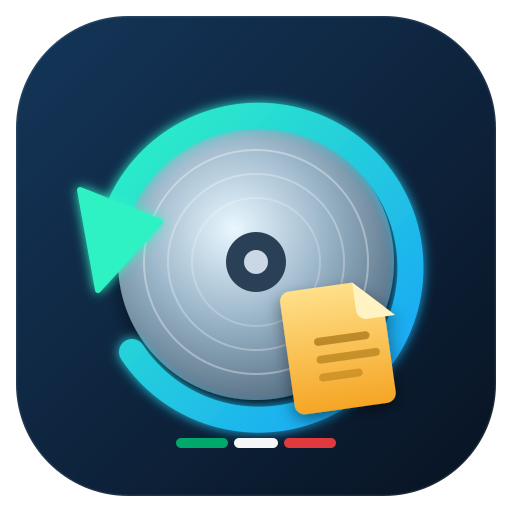
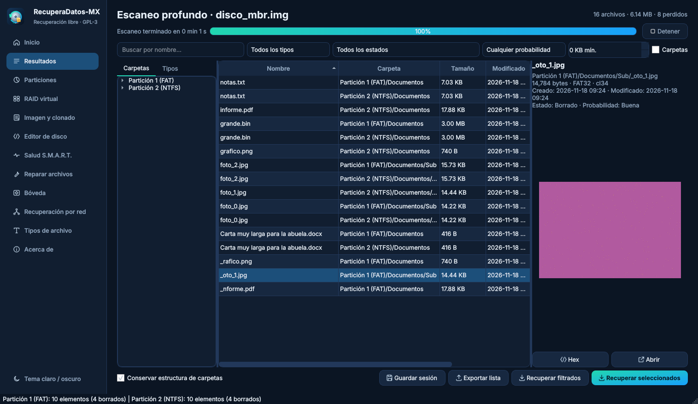

<p align="center">
  
</p>

<h1 align="center">RecuperaDatos-MX</h1>

<p align="center">
  Recuperación de datos profesional, <b>libre</b> y <b>sin límites</b> para Windows, macOS y Linux.<br>
  Licencia GPL-3.0 o posterior · Desarrollado por Santiago Miguel
</p>

<p align="center">
  <a href="../../releases/latest"><b>⬇ Descargar instaladores</b></a>
</p>

---

RecuperaDatos-MX reúne en una sola aplicación las capacidades de EaseUS Data Recovery
Wizard, R-Studio, DMDE y Disk Drill Enterprise: escaneo rápido y profundo, particiones
perdidas, RAID virtual, imágenes byte a byte, editor de disco, S.M.A.R.T., reparación de
archivos, bóveda de protección y recuperación por red. Consulte la
[investigación y matriz de funciones](docs/INVESTIGACION.md).



## Funciones

| | |
|---|---|
| **Escaneo rápido** | Lee la MFT de NTFS (incluidos archivos comprimidos y flujos alternos), FAT12/16/32 con nombres largos, exFAT, ext2/3/4 (con recuperación desde el journal) y HFS+. Conserva nombres, carpetas y fechas. |
| **Escaneo profundo** | Busca particiones perdidas, reconstruye NTFS a partir de registros MFT sueltos (discos formateados) y recupera por firmas más de 110 extensiones (fotos y RAW de cámara, video, audio, Office, PDF, comprimidos, correo, bases de datos, CAD, ejecutables…) validando su estructura para calcular el tamaño exacto. |
| **Resultados en vivo** | Los archivos aparecen mientras se escanea. Filtros por nombre, tipo, estado, probabilidad y tamaño; árbol de carpetas; vista previa de imágenes, PDF, texto y hexadecimal; recuperación conservando carpetas y fechas, con informe CSV. |
| **Particiones** | Lectura de MBR, particiones lógicas y GPT (con su copia), búsqueda rápida o completa de NTFS, FAT, exFAT, ext, HFS+, APFS y XFS, reparación del arranque NTFS y escritura de tablas MBR/GPT con respaldo previo. |
| **RAID virtual** | JBOD, RAID 0, 1, 1E, 4, 5, 6 y 10 con esquemas izquierda/derecha simétrico/asimétrico, retardo de paridad, desplazamientos, miembros faltantes y detección automática de parámetros. |
| **Imagen y clonado** | Copia byte a byte con reintento por sector, salto tras zonas dañadas, copia inversa, reanudación, MD5/SHA-256 e imágenes divididas. Clonar disco a disco y restaurar imágenes. |
| **Editor de disco** | Vista hexadecimal de discos completos, saltos por sector, búsqueda de texto/hex, plantillas (MBR, GPT, NTFS, FAT, ext, MFT) y edición confirmada. |
| **Salud S.M.A.R.T.** | Salud estimada, temperatura, horas, sectores reasignados/pendientes, desgaste NVMe y alertas, con vigilancia periódica. |
| **Reparar archivos** | JPEG truncados o con cabecera dañada (con foto de referencia), ZIP/DOCX/XLSX/PPTX/ODT/EPUB y PDF. |
| **Bóveda** | Registra nombre y ubicación física de los archivos de carpetas protegidas para recuperarlos con su nombre si se borran. |
| **Recuperación por red** | Agente de solo lectura con clave para escanear discos de otra computadora. |
| **Línea de comandos** | Todas las funciones principales sin interfaz gráfica. |

Todos los botones muestran una descripción emergente (tooltip) al pasar el cursor.

## Instalación

Descargue el instalador de su sistema desde [Releases](../../releases/latest):

* **Windows 10/11:** `RecuperaDatos-MX-…-windows-setup.exe` (o el `.zip` portátil).
* **macOS:** `…-macos-arm64.dmg` (Apple Silicon) o `…-macos-x86_64.dmg` (Intel). Arrastre la
  app a Aplicaciones. Como la app no está firmada por Apple, la primera vez abra con clic
  derecho → *Abrir*. Para leer discos internos conceda *Acceso total al disco*.
* **Debian/Ubuntu/Mint:** `sudo apt install ./recuperadatos-mx_…_amd64.deb`
* **Fedora/openSUSE/RHEL:** `sudo dnf install ./recuperadatos-mx-….x86_64.rpm`

Para leer discos físicos ejecute la aplicación como administrador (en Windows lo pide al
abrir; en Linux/macOS use el botón *Reiniciar como administrador*). S.M.A.R.T. usa
`smartctl` del paquete [smartmontools](https://www.smartmontools.org).

### Desde el código fuente

```bash
pip install -r requirements.txt
python -m recuperadatos_mx            # interfaz gráfica
python packaging/build.py             # compilar instaladores de la plataforma actual
```

## Línea de comandos

```bash
recuperadatos-mx listar
recuperadatos-mx escanear /dev/sdb --profundo --sesion usb.rdsesion
recuperadatos-mx recuperar usb.rdsesion /media/destino --borrados --tipo Imágenes
recuperadatos-mx particiones disco.img --buscar
recuperadatos-mx imagen /dev/sdb respaldo.img --inverso
recuperadatos-mx smart /dev/sda
recuperadatos-mx agente --clave MiClaveSegura
recuperadatos-mx reparar foto.jpg --referencia otra_foto_misma_camara.jpg
```

## Buenas prácticas

1. Deje de usar la unidad afectada en cuanto note la pérdida.
2. Nunca recupere archivos en la misma unidad (la app le advierte si lo intenta).
3. Si el disco hace ruidos o tiene sectores dañados, cree primero una imagen byte a byte y
   recupere desde la imagen.

## Pruebas

Las pruebas crean sistemas de archivos reales (FAT32, exFAT, NTFS, ext4 y un disco MBR),
borran archivos y verifican que se recuperan con la misma huella SHA-256:

```bash
sudo python tests/build_images.py /tmp/rdt
RD_IMAGES=/tmp/rdt python -m pytest tests
```

## Limitaciones conocidas

Vea la sección 3 de [docs/INVESTIGACION.md](docs/INVESTIGACION.md). En resumen: APFS, ReFS,
Btrfs y XFS se detectan y se recuperan por firmas, pero aún no se lee su árbol de archivos;
no hay soporte para volúmenes cifrados ni imágenes E01.

## Licencia

Copyright © 2026 Santiago Miguel — chago2850@gmail.com — 744 354 8848

Este programa es software libre: puede redistribuirlo y/o modificarlo bajo los términos de
la Licencia Pública General GNU publicada por la Free Software Foundation, ya sea la
versión 3 de la Licencia o (a su elección) cualquier versión posterior. Consulte
[LICENSE](LICENSE).
